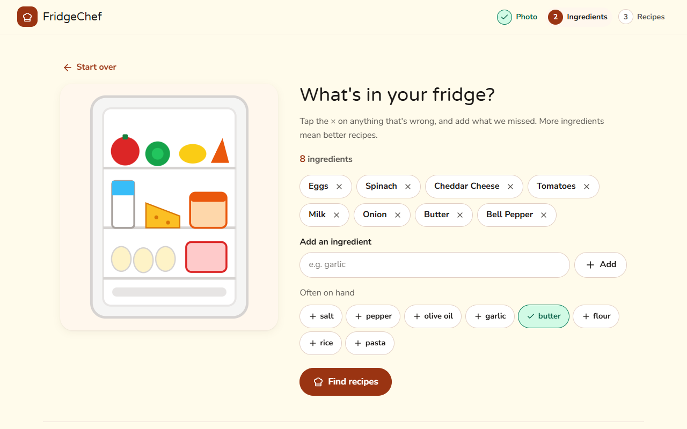
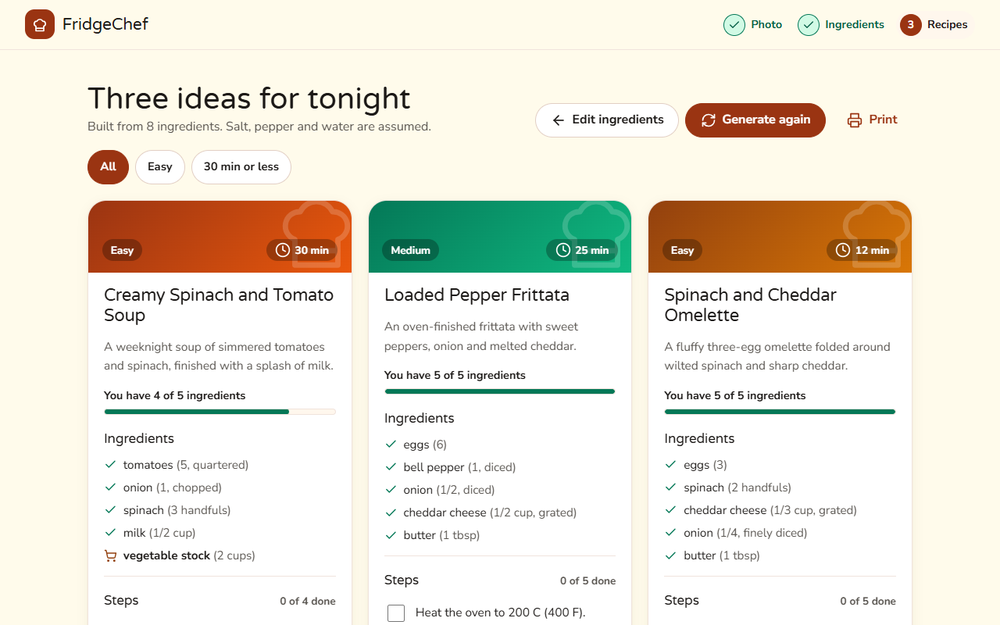

# FridgeChef

Take a photo of your fridge. Get three recipes back.

FridgeChef sends the photo to Google Cloud Vision for ingredient detection, lets you edit the result as chips, then asks Gemini 2.5 Flash for three complete recipes with ingredients, timings, and steps.


| Check the ingredients | Pick a recipe |
|---|---|
|  |  |

*Screens from the demo mode, which uses sample data.*

## Live demo

**[Try the demo](https://shreyask06.github.io/FridgeChef/)** on GitHub Pages. Pages has no backend, so the demo runs in a sample-data mode (`frontend/demo.js`): any photo returns a sample ingredient list, and the recipes are picked from a small built-in set by ingredient overlap. It shows the full flow (upload, edit ingredient chips, get three recipes, generate again) without calling Vision or Gemini. Run the app locally, as below, for real detection and generation. Append `?demo=1` to a local URL to try the demo mode there.

## Requirements

- Python 3.11+
- A Google Cloud project with the **Vision API** enabled, plus a service-account JSON key
- A **Gemini API key** from [Google AI Studio](https://aistudio.google.com/app/apikey)

## Setup

1. Clone and enter the repo.
2. Create a virtualenv and install deps:
   ```
   python -m venv .venv
   # macOS/Linux: source .venv/bin/activate
   # Windows PowerShell: .venv\Scripts\Activate.ps1
   pip install -r backend/requirements.txt
   ```
3. Copy `backend/.env.example` to `backend/.env` and fill in both credentials.
4. Run the server:
   ```
   uvicorn backend.main:app --reload
   ```
5. Open [http://localhost:8000](http://localhost:8000).

## Tests

```
pytest
```

17 tests covering the food-filter logic and both API routes (Vision and Gemini clients mocked).

## Frontends

Two are available; pick whichever fits.

- **Web** (`frontend/`) — vanilla HTML/CSS/JS. Served automatically at `http://localhost:8000` by the backend. No build step.
- **Android** (`flutter_app/`) — native Flutter app with camera + gallery picker. See [`flutter_app/README.md`](flutter_app/README.md) for Flutter SDK setup, emulator config, and how to run on a physical device.

Both talk to the same `/api/detect` and `/api/recipes` endpoints.

## The web UI

- **Three clear steps** with a progress indicator: photo, ingredients, recipes.
- **Scanning feedback** while the photo is analysed, and skeleton cards while recipes are generated, so the page never looks frozen.
- **Editable ingredient chips** with a visible label, one-tap pantry staples, and an empty state.
- **"You have X of Y" matching** on every recipe: ingredients you already have are ticked, the rest are marked to buy, and **Shopping list** copies just those. Matching compares whole words, so "egg" matches "eggs" but not "eggplant"; salt, pepper and water are assumed.
- **Tick-off steps** with a progress count, **Copy recipe**, filters (Easy, 30 min or less) and a print layout.
- **Accessible by default:** keyboard-operable drop zone, visible focus rings, labelled controls, live status announcements, focus moved to each step's heading, 44px touch targets, and reduced-motion support.
- **Light and dark themes** from one set of colour tokens, responsive down to 375px, and no build step (plain HTML, CSS and JavaScript). Model-generated text is inserted with `textContent`, never as HTML.

## Roadmap

Ideas, roughly in order of value for effort:

1. **Preferences in the request.** Let the user set diet (vegetarian, vegan, gluten-free), allergens to exclude, servings and a time budget, and pass them to Gemini. `IngredientsRequest` only carries ingredients today, so this is a small schema change plus a prompt change.
2. **Detect with Gemini directly.** Send the photo to Gemini 2.5 Flash instead of using Cloud Vision labels plus the food filter. It can read packaging, merge duplicates, and estimate quantities, and it removes a dependency and a credential. Compare the two on a labelled set before switching.
3. **A detection benchmark.** A small golden set of fridge photos with expected ingredients, scored for precision and recall, so changes to detection (or the food filter) are measured rather than judged by eye.
4. **Faster perceived speed.** Resize and compress photos in the browser before upload (smaller and quicker), and stream recipes so the first card appears before all three are done.
5. **Resilience.** Retry once when the model returns malformed JSON, and cache results by a hash of the ingredient list to cut cost and latency.
6. **Make the live demo real.** Host the backend (with keys as host secrets, request limits and CORS for the Pages origin) and add an `API_BASE` setting to the frontend, so the Pages site can run the real pipeline instead of sample data.
7. **Remember things.** Saved recipes, a history of past fridges, and a remembered pantry, in the browser first and an account later.
8. **Nutrition and allergen flags** on each recipe, ideally grounded in a food database rather than model guesses.
9. **Frontend tests.** A Playwright smoke test of the three steps and the failure paths, alongside the 17 backend tests.
10. **Bring the Flutter app up to the same flow** (matching, shopping list, tick-off steps).

## Architecture

See [docs/superpowers/specs/2026-04-23-fridgechef-design.md](docs/superpowers/specs/2026-04-23-fridgechef-design.md) for the full design.
